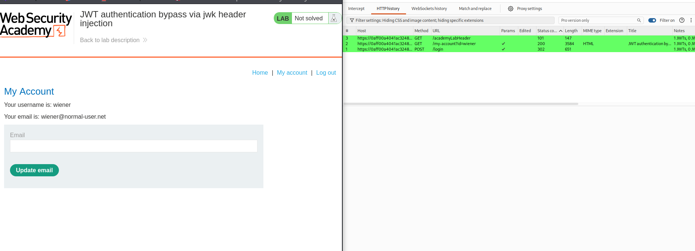
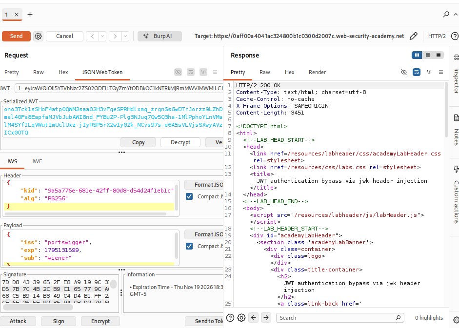
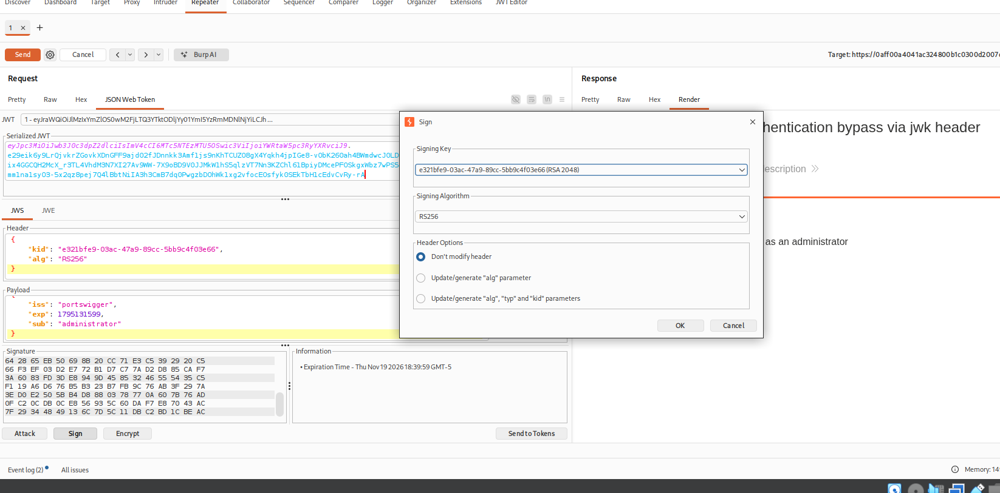
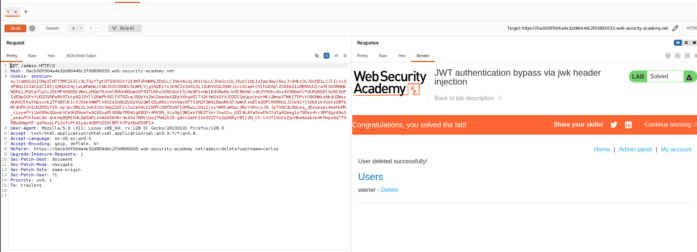

# JWT Authentication Bypass via JWK Header Injection

**Plateforme :** PortSwigger Web Security Academy  
**Laboratoire :** [JWT authentication bypass via JWK header injection](https://portswigger.net/web-security/jwt/lab-jwt-authentication-bypass-via-jwk-header-injection)  
**Catégorie :** Web Security · Authentication · JWT Attacks  
**Outils :** Burp Suite · JWT Editor  
**Type de vulnérabilité :** Authentication bypass / JWT header injection

> **Périmètre :** exercice réalisé dans le laboratoire prévu à cet effet sur PortSwigger Web Security Academy.

## 1. Objectif

Le but de ce laboratoire est de comprendre comment une validation incorrecte du paramètre `jwk` dans le header d'un JWT peut permettre de falsifier un token et d'obtenir un accès administrateur.

L'objectif du laboratoire est de modifier le JWT de l'utilisateur `wiener` afin de s'authentifier en tant que `administrator`, d'accéder à `/admin`, puis de supprimer l'utilisateur `carlos`.

## 2. Rappel : structure d'un JWT

Un JWT (*JSON Web Token*) est composé de trois parties séparées par des points (`.`) :

| Partie | Rôle |
|---|---|
| Header | Indique notamment le type de token et l'algorithme utilisé. |
| Payload | Contient les claims, par exemple l'identité de l'utilisateur (`sub`). |
| Signature | Permet de vérifier l'intégrité du token et son authenticité par rapport à une clé donnée. |

Ces trois parties sont encodées en Base64URL. **Base64URL n'est pas du chiffrement** : les données du header et du payload peuvent être décodées et lues.

### Fonctionnement normal avec RS256

- Le serveur émetteur signe le JWT avec sa clé privée RSA.
- Le serveur destinataire vérifie la signature avec la clé publique correspondante.
- La clé publique doit être obtenue depuis une source de confiance, et non acceptée aveuglément depuis le token reçu.

## 3. Paramètres du header à connaître

- **`jwk` — JSON Web Key :** permet de représenter une clé cryptographique directement dans le header JWT. Dans ce laboratoire, la clé intégrée est une clé publique RSA.
- **`jku` — JSON Web Key Set URL :** indique une URL où un ensemble de clés publiques (JWKS) peut être récupéré.
- **`kid` — Key ID :** identifiant utilisé pour sélectionner une clé parmi plusieurs clés disponibles. À lui seul, il ne prouve pas que la clé est fiable.

## 4. Procédure du laboratoire

### Étape 1 — Se connecter

Se connecter au laboratoire avec les identifiants fournis :

- Username : `wiener`
- Password : `peter`

Intercepter la requête de compte, par exemple `GET /my-account`, et l'envoyer dans Burp Repeater.





### Étape 2 — Observer le contrôle d'accès

Dans Repeater, essayer d'accéder à `GET /admin` avec le JWT de `wiener`. Observer la réponse : l'utilisateur courant ne possède pas les privilèges administrateur.

### Étape 3 — Générer une paire de clés RSA

Dans Burp Suite :

1. Ouvrir l'onglet **JWT Editor Keys**.
2. Choisir **New RSA Key**.
3. Générer une nouvelle paire de clés RSA et l'enregistrer.

La paire contient :

- une **clé privée**, conservée dans JWT Editor et utilisée pour signer le token ;
- une **clé publique**, qui pourra être intégrée au header JWK.

La clé privée ne doit pas être publiée ni envoyée au serveur.

### Étape 4 — Modifier le claim `sub`

Dans l'éditeur JWT de Burp, modifier le claim `sub` du payload pour remplacer l'utilisateur `wiener` par `administrator`.

Exemple conceptuel :

```json
{
  "sub": "administrator"
}
```

Cette modification change le contenu du token. La signature existante ne correspond donc plus au nouveau contenu : il faut signer à nouveau le JWT avec la clé RSA générée.



### Étape 5 — Intégrer la clé publique avec Embedded JWK

Dans l'onglet **JSON Web Token** de Burp :

1. Cliquer sur **Attack**.
2. Choisir **Embedded JWK**.
3. Sélectionner la paire RSA créée précédemment.
4. Valider l'opération.

JWT Editor intègre la clé publique dans le header `jwk`, adapte le `kid` si nécessaire et signe le token avec la clé privée sélectionnée.

Le header obtenu ressemble à cet exemple simplifié :

```json
{
  "alg": "RS256",
  "kid": "key-id-de-la-cle",
  "jwk": {
    "kty": "RSA",
    "e": "AQAB",
    "kid": "key-id-de-la-cle",
    "n": "modulus-de-la-cle-publique"
  }
}
```

Le JWK intégré contient les paramètres publics (`kty`, `n`, `e`, et éventuellement `kid`). Il ne doit pas contenir les paramètres privés RSA comme `d`, `p` ou `q`.

### Étape 6 — Envoyer le token modifié

Envoyer la requête vers `/admin` avec le JWT modifié. Dans ce laboratoire vulnérable, le serveur accepte la clé publique intégrée dans `jwk` pour vérifier la signature, sans s'assurer correctement que cette clé provient d'une source de confiance.

Le token est alors accepté avec le claim `sub` modifié, ce qui permet d'accéder à l'espace administrateur.

### Étape 7 — Terminer le laboratoire

Depuis l'interface administrateur, repérer l'action de suppression de l'utilisateur `carlos` et l'effectuer conformément aux instructions du laboratoire. Vérifier ensuite que PortSwigger indique que le laboratoire est résolu.



## 5. Pourquoi l'attaque fonctionne-t-elle ?

L'attaque ne casse pas RSA et ne permet pas de retrouver la clé privée du serveur.

L'attaquant génère sa propre paire RSA, signe le JWT avec sa clé privée et fournit la clé publique correspondante dans le header `jwk`. Le serveur vulnérable accepte cette clé contrôlée par le client pour vérifier la signature.

La signature est donc mathématiquement valide par rapport à la clé publique fournie. Cependant, cette vérification ne prouve pas que le token a été signé par un émetteur autorisé : le serveur a fait confiance à une clé choisie par l'utilisateur.

| Implémentation sécurisée | Implémentation vulnérable du laboratoire |
|---|---|
| La clé de vérification vient d'une source de confiance configurée par le serveur. | Le serveur accepte la clé publique fournie dans le JWT sans validation suffisante de sa provenance. |
| La signature est vérifiée avec une clé autorisée. | La signature est vérifiée avec la clé contrôlée par l'attaquant. |

**Point essentiel sur RSA :** la clé privée sert à signer ; la clé publique correspondante sert à vérifier. Le vérificateur n'a pas besoin de connaître la clé privée.

## 6. Mesures de protection

- Ne pas faire confiance à une clé fournie dans le JWT simplement parce qu'elle se trouve dans `jwk`.
- N'accepter que des clés de vérification provenant d'une source de confiance et associées à l'émetteur attendu.
- Valider strictement l'algorithme autorisé et la configuration de vérification ; ne pas laisser le token imposer librement la politique cryptographique.
- Vérifier les claims pertinents (`iss`, `aud`, `exp`, et les droits associés à l'utilisateur) côté serveur.
- Appliquer les contrôles d'autorisation côté serveur pour chaque ressource et chaque opération sensible.

## 7. Ce que j'ai appris

- Identifier les trois parties d'un JWT et comprendre le rôle de chacune.
- Distinguer une clé publique RSA d'une clé privée RSA.
- Comprendre les paramètres `jwk`, `jku` et `kid`.
- Utiliser Burp Suite et JWT Editor pour examiner et modifier un JWT dans un laboratoire autorisé.
- Comprendre pourquoi une signature peut être valide mathématiquement tout en reposant sur une clé non fiable.
- Relier une mauvaise gestion de la confiance à un contournement d'authentification et à une élévation de privilèges.

## 8. Référence

- [PortSwigger Web Security Academy — JWT authentication bypass via JWK header injection](https://portswigger.net/web-security/jwt/lab-jwt-authentication-bypass-via-jwk-header-injection)
